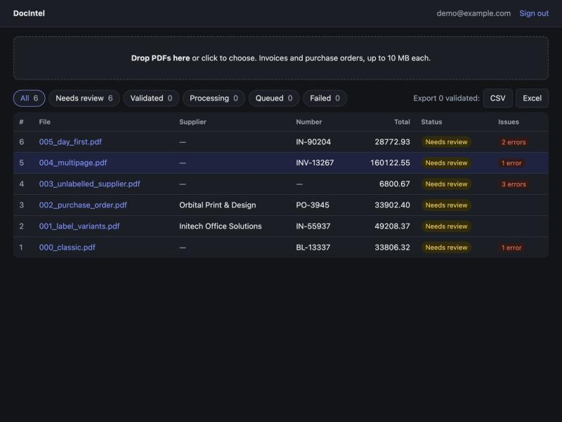
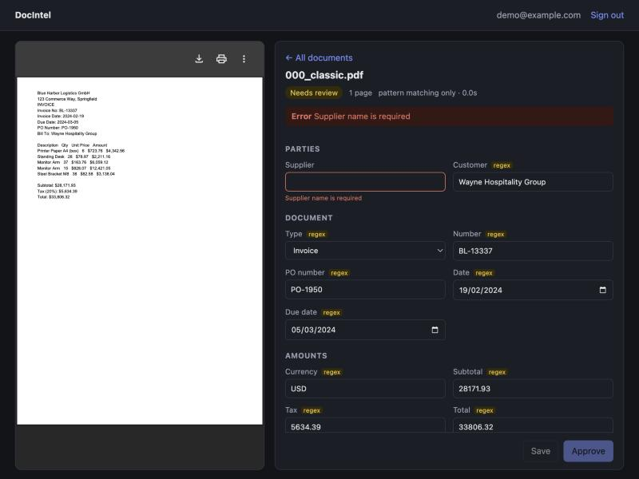
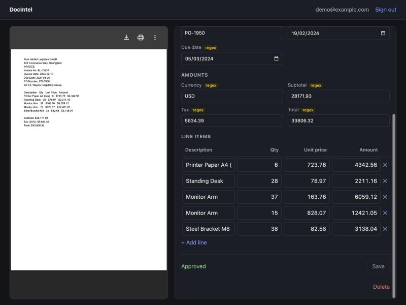

# DocIntel

**Turn invoice and purchase-order PDFs into checked, structured records.**

DocIntel reads business documents with an LLM, checks every extracted value with deterministic rules, and
puts a person in charge of the final say: nothing is exported until a reviewer has seen it and the numbers add
up. It runs entirely on your own machine with a small local model, or against any OpenAI-compatible API.

| Documents | Review with a flagged error | Approved |
|---|---|---|
|  |  |  |

*Screenshots are from a local run in regex-only mode (no model), which is why every field is tagged `regex`.*

## What it does

### 1. Upload
Drag and drop one or many PDFs (up to 20 per upload, 10 MB and 50 pages each). Files are checked by content,
not by name — anything that isn't a real PDF is rejected with a clear message. Uploading the same file twice
returns the existing record instead of creating a duplicate. Uploads return immediately; extraction runs in the
background and the list updates as each document finishes.

### 2. Extract
Each document goes through a fixed pipeline:

1. **Read the PDF text** page by page (long documents are split into chunks).
2. **Ask the model once per chunk** for a JSON object with the fields below — temperature 0, JSON mode.
3. **Coerce every value into a typed schema.** Money becomes an exact decimal, dates become ISO dates. A value
   the model got wrong (`"about 500"`, `"ten"`) is dropped and flagged, without losing the rest.
4. **Fill gaps and cross-check with pattern matching.** If the model missed a labelled field, regex fills it;
   if the model and the printed total disagree, that's flagged.

| Extracted fields | |
|---|---|
| Document | type (invoice / purchase order), number, PO number, issue date, due date |
| Parties | supplier, customer |
| Amounts | currency, subtotal, tax, total |
| Line items | description, quantity, unit price, amount |

Every value records where it came from — `llm`, `regex`, or (after review) `edited` — and the UI shows it.

If the model is slow or down, the job is retried with backoff; if it never comes back, the document still
gets a pattern-matching draft with a warning, rather than failing. Scanned (image-only) PDFs are rejected
clearly — there's no OCR.

### 3. Validate
Deterministic Python rules run after every extraction and every edit. **Errors block approval;** warnings
are shown but don't.

- **Errors:** a required field (supplier, number, date, total) is missing · subtotal + tax ≠ total · line
  items don't sum to the subtotal · quantity × unit price ≠ line amount · negative amounts · a date in the
  future · due date before the issue date.
- **Warnings:** implausible tax rate · unknown currency · zero/negative quantity · a document number that
  doesn't appear anywhere in the PDF (guards against invented values) · a possible duplicate of another
  document from the same supplier · model and printed text disagree · model output unusable or unavailable.

Full list with codes: [API.md](docs/API.md#issue-codes).

### 4. Review and correct
The review screen shows the original PDF next to the extracted fields. Problems appear next to the field
they concern. Reviewers can edit any field, add or remove line items, save (rules re-run immediately), re-run
extraction, or delete the document. **Approve** is only enabled — and only accepted by the server — when no
errors remain.

### 5. Export
Approved documents export to **CSV** or **Excel** (the workbook has a `documents` sheet and a `line_items`
sheet). Cells that could be read as spreadsheet formulas are neutralised.

### Accounts and access
Email + password sign-in. Each user only ever sees their own documents; anyone else's document returns
"not found", so IDs can't be probed.

## How well it works

Measured on 30 synthetic PDFs (6 layouts: labelled, unlabelled, purchase orders, multipage, alternative
labels, UK day-first dates) on a MacBook Air M2 with 8 GB RAM, Ollama, 2026-10-29:

| Configuration | Field accuracy | Median time per document |
|---|---|---|
| Pattern matching only | 86.7 % | 0.01 s |
| **qwen2.5:1.5b (default)** | **96.9 %** | **10 s** |
| qwen2.5:3b | 96.3 % | 15 s |
| llama3.2:3b | 95.1 % | 12 s |
| llama3.2:1b | 85.1 % | 5 s |

On a third-party layout we didn't write (100 Northwind invoices and POs, script-parsed truth, cross-checked; not
yet hand-verified), **pattern matching alone reads only 21.6 % of printed fields; qwen2.5:1.5b reads 84.9 %**, but
it also invents values that aren't printed (currency on every invoice) and returns empty line items on 12 of 50
POs.

The model earns its place on fields patterns can't find — supplier name goes from 33 % to 97–100 %. Line
items are the weakest field for every model. The top three models are within run-to-run noise on a set this
small, and synthetic PDFs are cleaner than real ones: treat these as a regression benchmark, not production
accuracy. Method, per-field results and known failure cases: [EVALUATION.md](docs/EVALUATION.md).

## Run it

### With Docker (full stack)

The model runs outside the containers, on your machine, so it can use the GPU:

```bash
ollama pull qwen2.5:1.5b && ollama serve         # or set LLM_ENABLED=false for pattern matching only
export JWT_SECRET=$(openssl rand -hex 32)
docker compose up --build                        # http://localhost:8080
```

### Using a cloud model

Any OpenAI-compatible `/chat/completions` provider works (OpenAI, Groq, Together, OpenRouter, vLLM…). Set a
cloud model **and keep the local one as a backup**:

```bash
export CLOUD_LLM_BASE_URL=https://api.groq.com/openai/v1
export CLOUD_LLM_MODEL=llama-3.1-8b-instant
export CLOUD_LLM_API_KEY=...                    # cloud is used only when this is set
```

Each part of a document then goes **cloud → local model → pattern matching**: if the cloud is down, rate-limited,
out of credit or returns junk, the local model is tried; if no model gives a usable answer, pattern matching fills
in. The job is only retried when *every* model was unreachable. Each document records which model actually read
it. Set `LLM_BASE_URL=` (empty) to run cloud-only.

Cloud is strictly opt-in: with a cloud key set, **document text is sent to that provider**.

### Without Docker

SQLite and inline jobs, no Postgres or Redis needed:

```bash
cd backend
uv venv --python 3.12 .venv && uv pip install --python .venv -r requirements-dev.txt
DATABASE_URL=sqlite:///./data/dev.db UPLOAD_DIR=./data/uploads CELERY_EAGER=true \
  JWT_SECRET=$(openssl rand -hex 32) .venv/bin/uvicorn app.main:app --reload --port 8000

cd ../frontend && npm install && npm run dev     # http://localhost:5173
```

All settings are environment variables, listed in [`backend/app/config.py`](backend/app/config.py) and
[`backend/.env.example`](backend/.env.example).

## Test and evaluate

```bash
cd backend
.venv/bin/pytest -q                          # 90 tests, ~2 s, no model or network needed
.venv/bin/ruff check app tests eval
.venv/bin/python -m eval.generate            # rebuild the synthetic eval set
.venv/bin/python -m eval.import_company_docs --src ../dataset/CompanyDocuments   # optional third-party set
JWT_SECRET=x$(openssl rand -hex 16) .venv/bin/python -m eval.run_eval --no-llm   # pattern matching only
JWT_SECRET=x$(openssl rand -hex 16) .venv/bin/python -m eval.run_eval            # with the configured model
cd ../frontend && npm run build              # type-check + production build
```

Tests cover malformed and malicious uploads, wrong or garbled model output, model timeouts and outages,
every validation rule, cross-user access, and the full upload → review → approve → export flow. CI
(`.github/workflows/ci.yml`) runs them against PostgreSQL, builds the frontend, runs the eval and boots the
Docker stack.

## How it's built

| | |
|---|---|
| API | Python 3.12, FastAPI, Pydantic, SQLAlchemy |
| Storage | PostgreSQL (SQLite for local dev); uploaded files stored by content hash |
| Background jobs | Celery + Redis, with retries, time limits and safe re-delivery |
| Model | Any OpenAI-compatible endpoint over plain HTTP — local Ollama by default |
| UI | React + TypeScript (Vite), served by nginx |
| Delivery | Docker Compose, GitHub Actions |

One model call per chunk, then plain Python — no agent loop. Design decisions and diagrams in
[ARCHITECTURE.md](docs/ARCHITECTURE.md); endpoints in [API.md](docs/API.md) (Swagger UI at `/api/docs`);
the full write-up, including security and what's not done yet, in [WRITEUP.md](docs/WRITEUP.md).

```
backend/    API (app/), tests (tests/), eval harness + dataset (eval/), Dockerfile
frontend/   React app, nginx config, Dockerfile
docs/       architecture, API, evaluation, write-up, screenshots, OpenAPI spec
docker-compose.yml
```

## Deploy

Not deployed yet. The compose file is the deployment unit: on a single VM with Docker, run
`docker compose up -d` behind a TLS-terminating proxy, with `LLM_*` pointing at a hosted model (a small VM
can't run one well). Persistent state lives in the `pgdata` and `uploads` volumes.

## Limitations

No OCR for scanned PDFs. Dates like `06/11/2025` are read month-first, so UK dates can be silently swapped.
Pattern matching only understands English labels. No rate limiting on sign-in, no roles beyond document
owner, no database migrations yet. Export is CSV/Excel only — no accounting-system integration.
