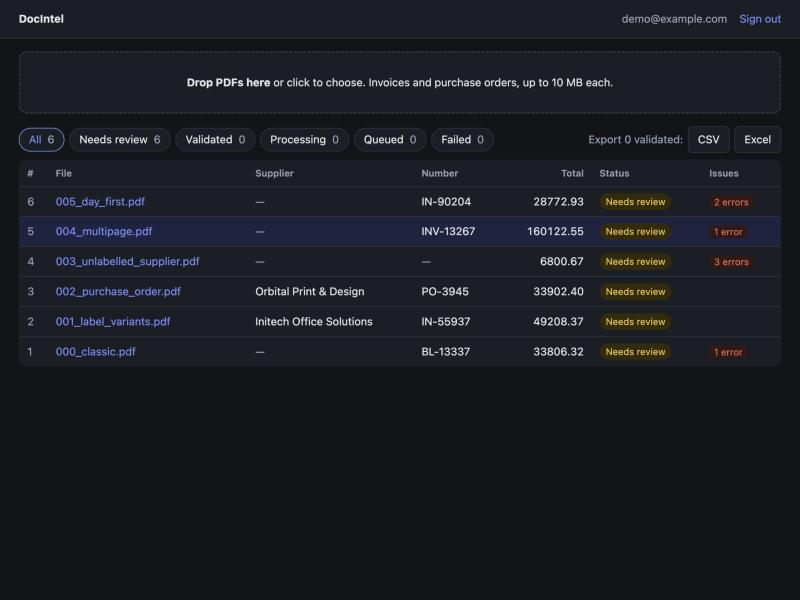
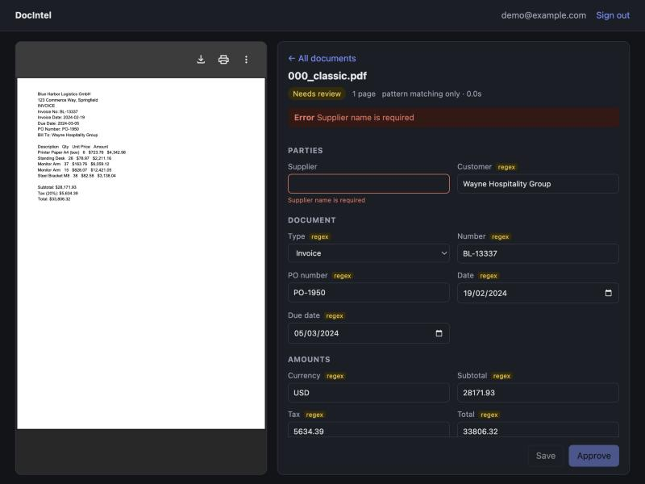
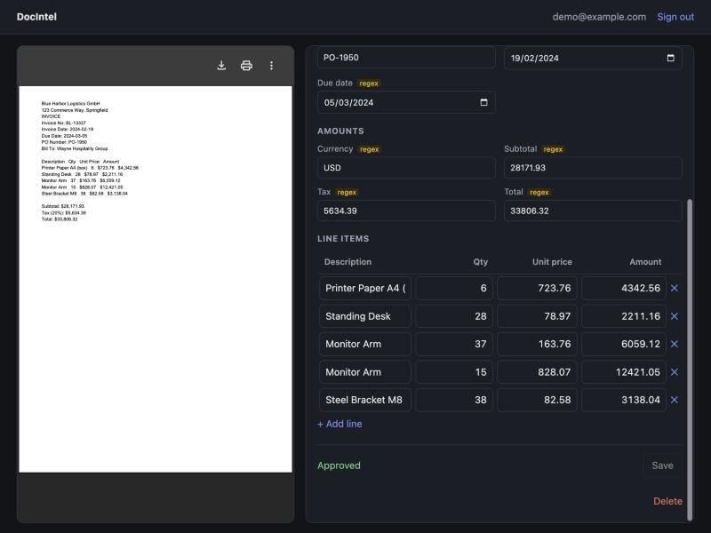

# DocIntel — Document Intelligence Platform

Upload invoices and purchase orders as PDFs, extract supplier / number / dates / tax / total / line items with
an LLM, check them with deterministic rules, review and correct them in a browser, and export approved records
to CSV or Excel.

**Stack:** Python 3.12 · FastAPI · PostgreSQL · Celery + Redis · React + TypeScript (Vite) · any
OpenAI-compatible LLM endpoint (local Ollama by default) · Docker Compose · GitHub Actions.

This grew out of the original prototype, now in [`Legacy/`](Legacy) (a Streamlit + LangChain order-extraction app, kept for reference). What carried over: the
LLM-then-regex pipeline idea, JSON-from-model parsing, chunk merging, PDF text extraction. What changed:
the domain (invoices/POs), a real backend with persistence and a job queue, deterministic validation, auth,
a review UI, tests against malformed input and bad model output, and a measured eval.

| Documents | Review with a flagged error | Approved |
|---|---|---|
|  |  |  |

*Screenshots are from a local dev run in regex-only mode (no model), which is why every field is tagged `regex`.*

## Docs

- [Architecture](docs/ARCHITECTURE.md) — component, pipeline and state diagrams; design decisions
- [API](docs/API.md) — endpoints, examples, issue codes ([OpenAPI spec](docs/openapi.json); Swagger at `/api/docs`)
- [Evaluation](docs/EVALUATION.md) — method, measured results, known failure cases
- [Technical write-up](docs/WRITEUP.md)

## Run it

### Docker (full stack)

Requires Docker. The LLM runs outside the stack: by default the containers call Ollama on your host.

```bash
ollama pull qwen2.5:1.5b && ollama serve         # or set LLM_ENABLED=false for regex-only
export JWT_SECRET=$(openssl rand -hex 32)
docker compose up --build                        # http://localhost:8080
```

To use a hosted model instead, set `LLM_BASE_URL`, `LLM_MODEL`, `LLM_API_KEY` to any OpenAI-compatible
`/chat/completions` provider before `docker compose up`.

### Local dev without Docker

SQLite + inline task execution (no Postgres/Redis needed):

```bash
cd backend
uv venv --python 3.12 .venv && uv pip install --python .venv -r requirements-dev.txt
DATABASE_URL=sqlite:///./data/dev.db UPLOAD_DIR=./data/uploads CELERY_EAGER=true \
  JWT_SECRET=$(openssl rand -hex 32) .venv/bin/uvicorn app.main:app --reload --port 8000

cd ../frontend && npm install && npm run dev     # http://localhost:5173 (proxies /api to :8000)
```

All settings are env vars, documented in [`backend/app/config.py`](backend/app/config.py) and
[`backend/.env.example`](backend/.env.example).

## Test and evaluate

```bash
cd backend
.venv/bin/pytest -q                          # 78 tests, ~2 s, no model or network needed
.venv/bin/ruff check app tests eval
.venv/bin/python -m eval.generate            # (re)build the 30-PDF synthetic eval set
JWT_SECRET=x$(openssl rand -hex 16) .venv/bin/python -m eval.run_eval --no-llm   # regex-only baseline
JWT_SECRET=x$(openssl rand -hex 16) .venv/bin/python -m eval.run_eval            # with the configured LLM
cd ../frontend && npm run build              # type-check + production build
```

**Measured** (30 synthetic PDFs, MacBook Air M2 8 GB, Ollama, 2026-10-29): regex-only 86.7 % field accuracy;
qwen2.5:1.5b 96.9 % (median 10 s/doc); qwen2.5:3b 96.3 %; llama3.2:3b 95.1 %; llama3.2:1b 85.1 %. The top
three are within run-to-run noise on a set this small. Details, caveats and failure cases in
[EVALUATION.md](docs/EVALUATION.md).

## Deploy

Not deployed yet. The compose file is the deployment unit: on a single VM (any provider) with Docker,
`docker compose up -d` behind a TLS-terminating proxy, with `LLM_*` pointing at a hosted OpenAI-compatible
endpoint (a small VM can't run the model well). Persisted state is the `pgdata` and `uploads` volumes.

## Layout

```
backend/    FastAPI app (app/), pytest suite (tests/), eval harness + dataset (eval/), Dockerfile
frontend/   React + TypeScript SPA, nginx config, Dockerfile
docs/       architecture, API, evaluation, write-up, screenshots, openapi.json
docker-compose.yml
.github/workflows/ci.yml   lint, tests on Postgres, frontend build, eval, compose smoke test
Legacy/     original Streamlit prototype (V1), reference only — not built, tested or deployed
```
