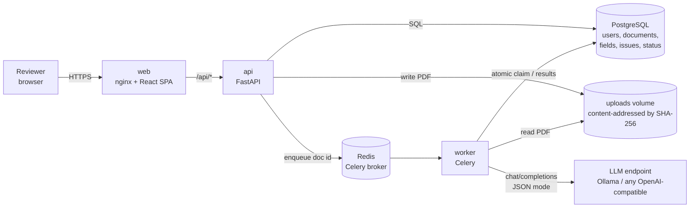
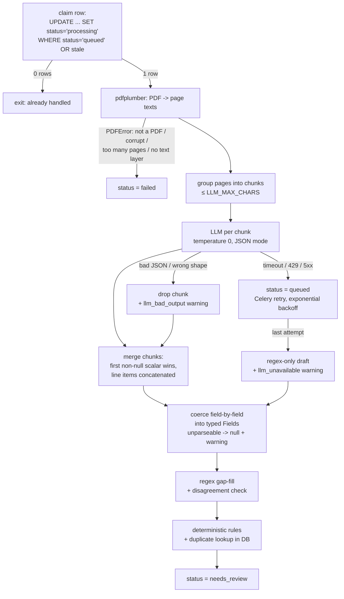
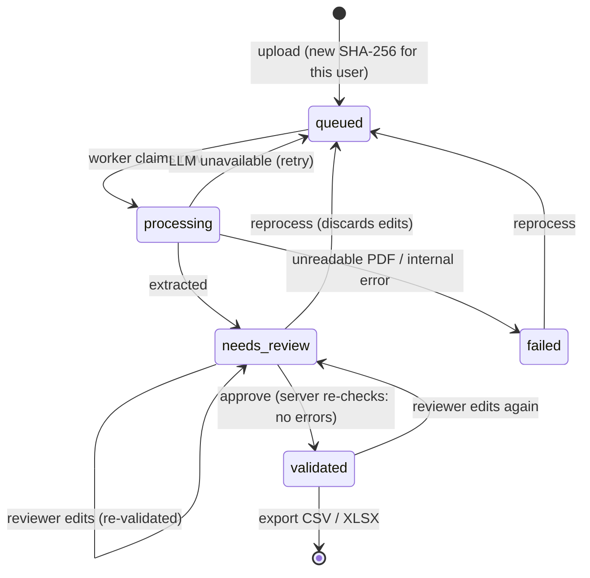

# Architecture

## Components



Five containers (`docker-compose.yml`): `db`, `redis`, `api`, `worker`, `web`. `api` and `worker` are the same
image with different commands. The LLM is deliberately outside the stack: it's an HTTP dependency selected by
`LLM_BASE_URL`, so the same code runs against local Ollama or a hosted endpoint.

## Processing pipeline (one Celery task per document)



Only one step calls a model. Everything after it is plain, unit-tested Python, so a given model output always
produces the same fields and the same issues.

## Document lifecycle



## Key design decisions

| Decision | Why | Trade-off / upgrade path |
|---|---|---|
| Fixed pipeline, no agent framework | Extraction is one well-defined transform. An agent loop adds latency, cost and non-determinism without adding capability here. | If a document type genuinely needs tool use (e.g. looking up a supplier master), add that one call explicitly. |
| LLM via raw OpenAI-compatible HTTP (`httpx`), not LangChain | The legacy prototype (`Legacy/`) pulled ~40 transitive packages to make one call. Direct HTTP gives explicit timeout and error classification (retryable vs not). | — |
| Idempotency via a conditional `UPDATE` on the row | Works across retries, redelivery after a worker crash, and double-clicked "Reprocess". The queue can deliver twice; the database decides once. | Stale `processing` rows (crashed worker) are reclaimable after `STALE_PROCESSING_S`. |
| Duplicate uploads blocked by `UNIQUE(owner_id, sha256)` | Database constraint, so concurrent uploads of the same file can't both win. | Per-user, so users can't probe whether someone else uploaded a file. |
| Separate `extracted` (immutable) and `fields` (current) JSON | Keeps the model's original output for auditing and lets you measure how much reviewers correct. | — |
| Money as `Decimal`, serialised as strings | Floats make `subtotal + tax == total` checks flaky. | — |
| Regex as gap-filler *and* cross-check | Fills fields the model leaves empty and flags when model and labelled text disagree on total / number. | Regex patterns are English, label-driven. |
| `create_all` instead of Alembic | One schema version so far. | Add Alembic before the first schema change on real data. |
| PDFs on a shared volume, not in Postgres | Keeps the DB small; files are content-addressed so the path is never user-controlled. | Swap `store_file`/`file_path` for S3 when there's more than one host. |

## Code map

```
backend/app/
  config.py      env-driven settings (pydantic-settings); JWT_SECRET is required
  db.py          SQLAlchemy models: User, Document; Status enum
  auth.py        scrypt password hashing, JWT issue/verify, current_user dependency
  fields.py      Fields/LineItem schema + lenient coercion of untrusted model output
  extraction.py  PDF -> text, chunking, LLM call, JSON parsing, regex fallback, merge
  rules.py       deterministic validation rules (pure functions)
  worker.py      Celery app, atomic claim, retry policy, file storage, DB-backed duplicate check
  main.py        FastAPI routes: auth, upload, list/detail, review, approve, reprocess, export
backend/tests/   pytest: unit (fields, rules, extraction) + API integration
backend/eval/    synthetic dataset generator, accuracy harness, results
frontend/src/    React + TypeScript: api.ts (typed client), App.tsx (login, list, review)
```
